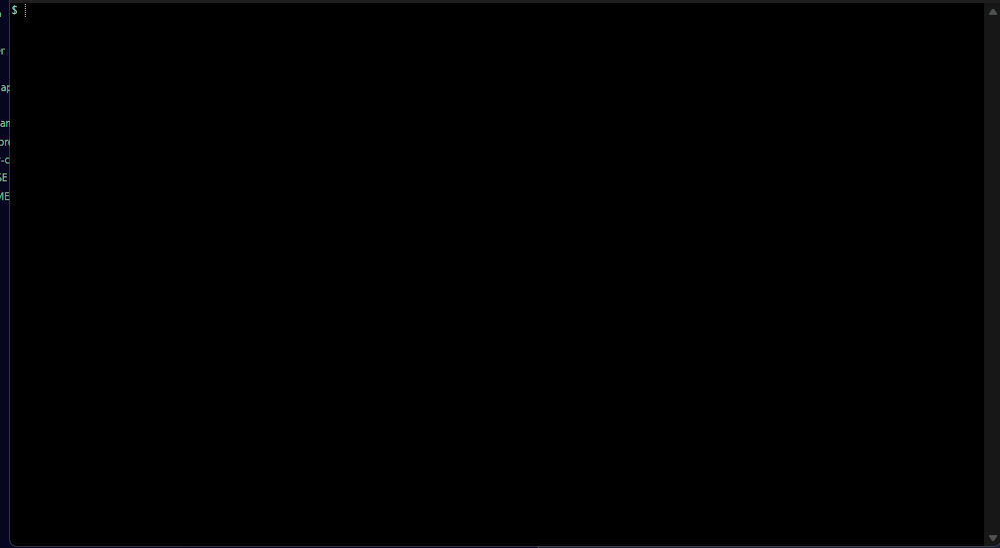

# Polarizer

An API authorization scanner, plus a deliberately vulnerable invoicing API to
demonstrate it. Polarizer replays requests across several user identities to find
broken authorization: cases where an API checks who you are but not what you are
allowed to do.

**Warning: this repo contains a deliberately insecure API. Run it only on your
own machine. Never deploy it. Only scan systems you own or are authorized to test.**



## Two parts

- **`target-api/`** a small fictional invoicing API (Node.js, Express, MongoDB).
  In `vulnerable` mode it has four common authorization flaws. In `fixed` mode the
  same code closes them. All data is fake.
- **`scanner/`** a Python CLI (`polarizer`) that reads an OpenAPI spec and tokens
  for test users, replays requests across them, and reports authorization
  failures as Markdown and JSON with an OWASP mapping. It exits non-zero on
  findings so it can gate CI.

## Quick start

Requires Docker and Python 3.11+.

```
# 1. Start the vulnerable lab (localhost only)
cp .env.example .env            # APP_MODE=vulnerable is the default
docker compose up -d --build

# 2. Install the scanner
cd scanner && pip install -e . && cd ..

# 3. Log in the fake test users and load their tokens
eval "$(python scanner/examples/get_tokens.py)"            # bash
#   on PowerShell: python scanner/examples/get_tokens.py --powershell  (run the printed lines)

# 4. Scan
python -m polarizer scan --config scanner/examples/lab.yaml --allow-writes
```

You should see five findings and exit code 1. Stop and reset the lab with
`docker compose down -v`.

Or run the whole thing, vulnerable then fixed, in one go:

```
bash scripts/demo.sh
```

## The flaws, their fixes, and how the scanner finds them

| Flaw | OWASP API Top 10 (2023) | Fix in `fixed` mode | Scanner check |
| --- | --- | --- | --- |
| Any user can read any invoice | API1 Broken Object Level Authorization | Lookup also matches the owner from the verified token; others get 404 | BOLA |
| Admin route has no role check | API5 Broken Function Level Authorization | Route requires the admin role, else 403 | BFLA |
| Profile update accepts any field, including `role` | API3 Broken Object Property Level Authorization | Only `name` and `email` are copied; the rest is ignored | Mass assignment |
| Tokens signed with a guessable secret | API2 Broken Authentication | Secret comes from `JWT_SECRET`; app refuses to start if it is missing or under 32 chars | Weak JWT secret (offline) |

## Running the fixed API

`fixed` mode needs a strong `JWT_SECRET` of at least 32 characters, or it refuses
to start (that refusal is the fix working). Generate one:

```
node -e "console.log(require('crypto').randomBytes(48).toString('hex'))"
```

Put it in `.env`, set `APP_MODE=fixed`, and `docker compose up --build`. A scan of
the fixed lab reports zero findings and exits 0.

## Test accounts

Fake accounts, lab database only.

| Email | Password | Role | Owns |
| --- | --- | --- | --- |
| `alice@example.test` | `alice-lab-password` | user | invoices 1001, 1002 |
| `bob@example.test` | `bob-lab-password` | user | invoices 1003, 1004 |
| `admin@example.test` | `admin-lab-password` | admin | - |

## Safety

- The API binds to `127.0.0.1` only, and Compose does not publish the database.
- The scanner refuses any non-localhost host unless you pass `--allow-host`, checks
  the host on every request, never follows redirects, and rate limits (default 5/s).
- Writes happen only with `--allow-writes`, are limited to the mass-assignment
  check, and are restored afterward. Tokens never appear in reports.

## Tests

```
cd target-api && npm ci && npm run test:common && npm run test:vulnerable && npm run test:fixed
cd ../scanner && pip install -e ".[dev]" && pytest -q
```

CI (`.github/workflows/ci.yml`) runs both test suites and then scans the live
lab, requiring the scanner to flag the vulnerable build and pass the fixed build.

## More

- [scanner/README.md](scanner/README.md) config, limits, false positives, and how
  this relates to the Autorize Burp extension.
- [docs/pentest-report.md](docs/pentest-report.md) a pentest-style write-up of the
  attack chain from normal user to admin takeover.

## Built with AI assistance

This project was built with help from Claude, an AI assistant.

## License

MIT, see [LICENSE](LICENSE).
